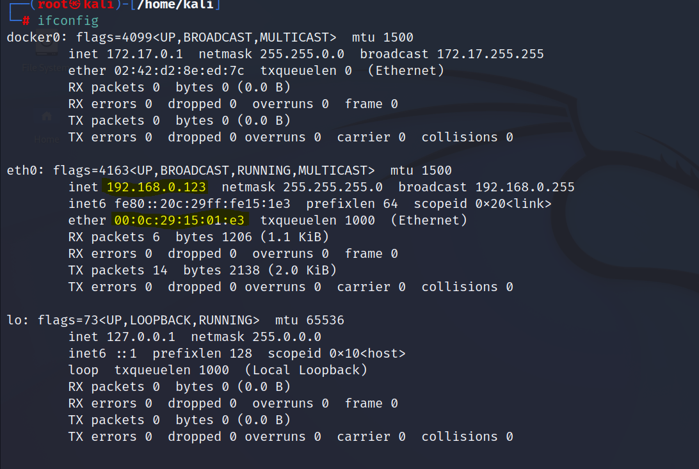
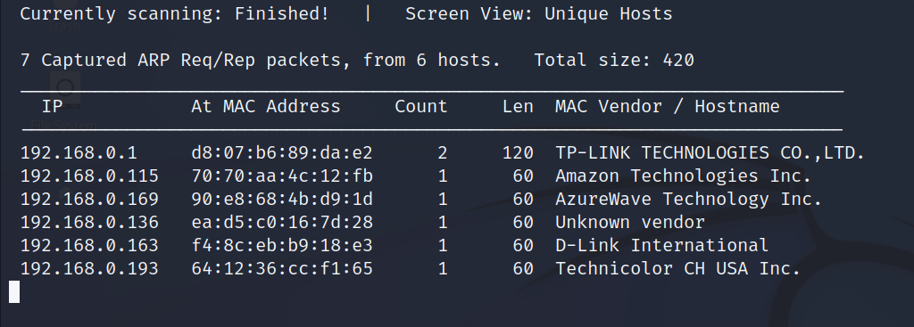
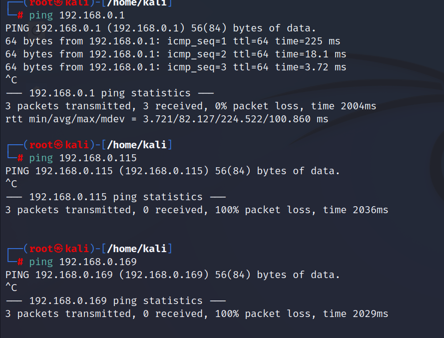
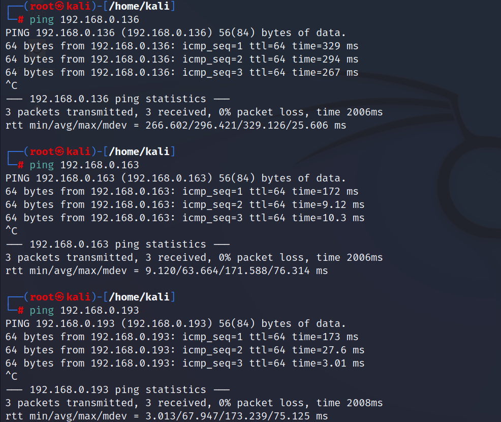
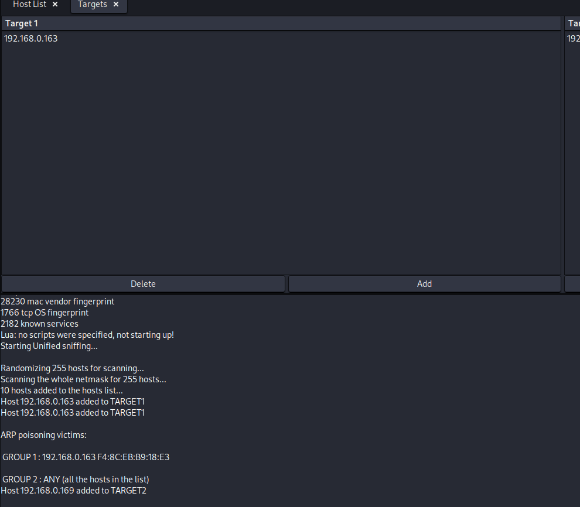
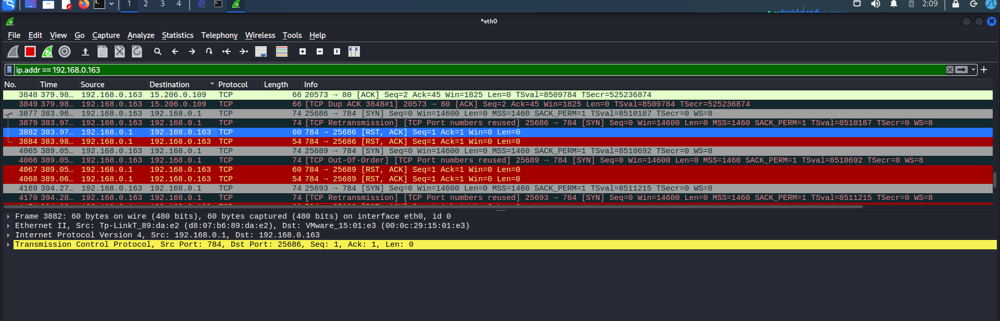
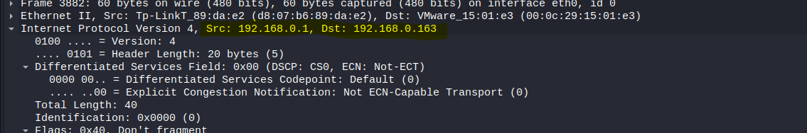
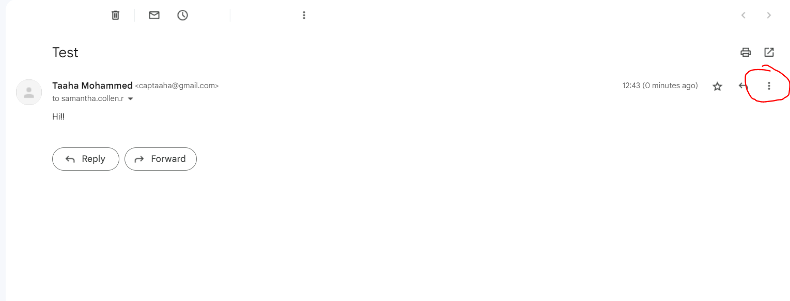

# CompTIA Security+ (SY0-601) Course Project

## University Cyber Attack — Incident Report

**Author:** Taaha Siddiqui Mohammed  
**Platform:** Kali Linux  
**Focus:** Network reconnaissance, vulnerability identification, man-in-the-middle analysis, and email forensics

> **Educational use only:** This repository documents a controlled lab exercise. Perform scanning, traffic interception, and vulnerability testing only on systems and networks you own or have explicit permission to assess.

---

## Project overview

This project applies CompTIA Security+ concepts to a simulated university cyber-attack scenario involving credential hijacking through a man-in-the-middle (MITM) attack. The investigation follows a practical incident-response workflow:

1. Identify the local network and discover active hosts.
2. Scan exposed services and investigate vulnerabilities.
3. Demonstrate MITM exposure using ARP poisoning and packet capture.
4. Trace the originating IP address of a sample email.
5. Consolidate the evidence into an incident report.

The complete course project is available in [`CompTIA_Securiy+_Project.pdf`](./CompTIA_Securiy%2B_Project.pdf).

## Incident summary

| Field | Finding |
|---|---|
| Threat | Credential hijacking through a MITM attack |
| Target | Samantha Collen R. — university faculty |
| Techniques | Social engineering, footprinting, ARP poisoning, traffic analysis, email forensics |
| Primary artifact | Victim's personal email account |
| Network gateway | `192.168.0.1` |
| Analyst/server IP | `192.168.0.123` |
| Identified target IP | `192.168.0.163` |
| Source MAC address | `90-E8-68-4B-D9-1D` |
| Destination MAC address | `00-0C-29-15-01-E3` |
| Email sender IP | `49.205.252.179` |

## Task 1 — Network discovery and port scanning

The investigation began by identifying the analyst machine's network configuration with `ifconfig`.

- Local analyst IP: `192.168.0.123`
- Default gateway: `192.168.0.1`
- Network range assessed: `192.168.0.123/24`

`netdiscover` identified six live hosts. Four hosts responded to ping, and Nmap was then used to identify exposed services. The documented scan identified open ports on `192.168.0.163`, described in the report as another router on the network.

> The source notes contain a few inconsistent labels and IP typos. This README preserves the primary values used in the incident report: analyst IP `192.168.0.123` and target IP `192.168.0.163`.

### Commands used

```bash
ifconfig
netdiscover -r 192.168.0.123/24
nmap <target-ip>
```

### Evidence










## Task 2 — Vulnerability and CVE review

The exposed services were compared with publicly documented vulnerabilities and CVSS scores from the National Vulnerability Database.

| Service/port | Vulnerability | CVSS | Severity | Reference |
|---|---|---:|---|---|
| HTTP / `80` | CVE-2021-41773 — Apache HTTP Server path traversal | 7.5 | High | [NVD](https://nvd.nist.gov/vuln/detail/CVE-2021-41773) |
| Sophos / `8192`, `8193` | CVE-2022-3236 — Sophos Firewall code injection | 9.8 | Critical | [NVD](https://nvd.nist.gov/vuln/detail/CVE-2022-3236) |
| OSPF-Lite / `8899` | CVE-2019-12676 | 7.4 | High | [NVD](https://nvd.nist.gov/vuln/detail/CVE-2019-12676) |

These findings should be treated as indicators for further validation, not proof that every listed vulnerability is exploitable on the target. Version fingerprinting and vendor-specific verification are required before remediation decisions are made.

### CVE evidence


## Task 3 — MITM analysis

Ettercap was used in a controlled environment to perform ARP poisoning against the identified target. Wireshark was then used to inspect the resulting traffic and verify whether the target's communications could be observed or manipulated.

The exercise indicates that the target was exposed to a MITM condition. This demonstrates the risk of relying on unauthenticated ARP resolution and unprotected network traffic.

### Evidence







## Task 4 — Email forensics

A sample email was sent to the target account, and the **Show original** option was used to inspect the message headers. The extracted sender IP was then reviewed with an external IP-tracing service:

- Sender IP: `49.205.252.179`
- [IP2Location lookup](https://www.ip2location.com/49.205.252.179)

Email headers can be affected by forwarding services, gateways, VPNs, and provider-specific formatting. The sender IP should therefore be corroborated with additional header fields and provider logs when conducting a real investigation.



## Task 5 — Incident response report

### Threat description

Credential hijacking using a man-in-the-middle attack.

### Threat target

Samantha Collen R., a university faculty member.

### Attack techniques

- Social engineering
- Network footprinting
- ARP poisoning
- MITM traffic interception
- Email-header analysis

### Collected artifacts

1. Analyst/server IP: `192.168.0.123`
2. Target IP: `192.168.0.163`
3. Default gateway: `192.168.0.1`
4. Identified CVE-2021-41773 with a reported CVSS score of 7.5
5. Additional service findings for Sophos and OSPF-Lite
6. Source MAC: `90-E8-68-4B-D9-1D`
7. Destination MAC: `00-0C-29-15-01-E3`
8. Email sender IP: `49.205.252.179`
9. Wireshark and Ettercap evidence showing MITM exposure

### Recommended countermeasures

- Patch or upgrade exposed Apache, Sophos, and OSPF-related services after confirming affected versions.
- Disable unnecessary services and restrict management ports with firewall rules and network ACLs.
- Use HTTPS/TLS, secure email transport, and certificate validation for sensitive communications.
- Enable switch protections such as DHCP snooping, Dynamic ARP Inspection, and port security where supported.
- Segment faculty, administrative, guest, and infrastructure networks using VLANs and least-privilege access rules.
- Monitor ARP tables and network anomalies through centralized logging or an IDS/IPS.
- Require phishing awareness training and multi-factor authentication for email accounts.
- Preserve packet captures, email headers, timestamps, and system logs as forensic evidence.

## Tools used

- **Kali Linux** — security testing platform
- **ifconfig** — local interface and MAC/IP inspection
- **Netdiscover** — host discovery
- **Nmap** — port and service enumeration
- **Ettercap** — controlled ARP-poisoning demonstration
- **Wireshark** — packet capture and traffic analysis
- **NVD and IP2Location** — vulnerability and IP intelligence references

## Repository contents

| File | Purpose |
|---|---|
| [`CompTIA_Securiy+_Project.pdf`](./CompTIA_Securiy%2B_Project.pdf) | Full course project report |
| `ifconfig.PNG` | Local interface configuration |
| `netdiscover.PNG` | Host discovery results |
| `nmap scan.PNG` | Port scan results |
| `ettercap.PNG` | ARP-poisoning/MITM evidence |
| `Wireshark1.PNG`, `Wireshark2.PNG` | Packet-analysis evidence |
| `email.PNG` | Email-header evidence |
| `http cve.PNG`, `sophos cve.PNG`, `ospf cve.PNG` | CVE research evidence |
| `ping1.PNG`, `ping2.PNG` | Connectivity-test evidence |

## Learning outcomes

This project demonstrates practical application of Security+ topics including reconnaissance, attack-surface analysis, vulnerability assessment, social engineering awareness, network attacks, packet analysis, digital evidence collection, and incident-response reporting.

---

**Author:** Taaha Siddiqui Mohammed  
**Repository:** [CapTaaha/Incident_Report_Simplilearn](https://github.com/CapTaaha/Incident_Report_Simplilearn)
